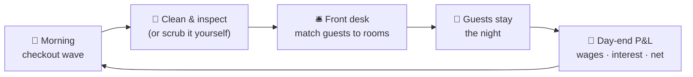

# Old Town Hotel 🏨

**A cozy, retro hotel-management sim built solo in Unity 6 — take over a run-down old-town hotel, inherit its $183,000 debt, and clean, staff, and renovate your way back to glory.**


<sub>Solo portfolio project by **Percy Wu**. The mechanics are real hotel-operations domain knowledge — front desk, housekeeping, room turnover, RevPAR-style economics — turned into a warm, fun-first management game. See the [changelog](CHANGELOG.md) for development history.</sub>

| Front Desk | Rooms | The Lounge |
|:---:|:---:|:---:|
|  |  |  |

---

## 🎮 The game


### Director controls and free camera — 22 October 2026

The main loop now starts in **Director / 经营指挥** mode: select an entire room to restore, upgrade or prioritize its service, and inspect staff remotely. Idle workers take priority rooms before their normal queue while existing jobs finish. The manager remains available in **Walk / 亲自巡视** mode for personal visits and on-site interactions.

Drag to pan; use the wheel or pinch to zoom; right-drag or twist two fingers to orbit. The camera panel provides rotation, overhead view and reset. **Floor / 楼层** changes the viewed floor, and **Room Navigation / 房间导航** shows all 50 rooms on a guest floor with direct travel to any wing. WASD/arrows pan, Q/E rotate, F locates the manager, and Tab switches control mode. Planning pause keeps the camera usable; the speed control cycles through 1×, 3× and 6×.

Walls on the camera side cut away automatically, room text faces the camera, selection outlines identify the target, and compact action cards leave more of the hotel visible. Camera composition, control mode and service priorities are saved alongside existing progress.

| Direct room service | Free overhead camera | Room navigation |
|:---:|:---:|:---:|
|  |  |  |

Validation: 796 EditMode, 22 PlayMode and 480 simulation tests pass. A live 6× operations review completed cleaning/inspection, increased sellable stock and rolled into the next morning without runtime errors.

### District empire map — 22 October 2026

Tap **Empire / 帝国** to open an illustrated district with seven individual hotels. Start at Old Town Hotel, acquire Station House, then expand along the market and canal routes. Riverside Grand requires both routes. Each hotel pin shows ownership, availability or its locked state; its detail card explains prerequisites, price, operating costs and daily net receipts.

Purchases charge once, open the next locations, update the map and request an autosave. Acquired properties run under resident managers and contribute to the existing daily settlement and seasonal economy. Earlier portfolio saves receive map locations while retaining all owned hotels, types and income. **Home Investment / 本店投资** keeps the original room renovation, warehouse and facility controls available.


Validation: 788 EditMode tests, 11 scene PlayMode tests and 480 simulation tests pass. New coverage includes both unlock routes, affordability, duplicate purchases, old-save migration, map hit testing, purchase feedback and returning to local hotel controls. The original map asset and its generation prompt live in `Assets/Game/Resources/HotelArt/Empire` and `Assets/Game/Art/Empire/GenerationRecord.json`.

### Textures and interior lighting — 22 October 2026

Walnut grain, lime plaster and woven linen now use original tileable texture assets with world-space PBR shading and surface relief. Beveled furniture edges, folded curtains, cushion shapes, detailed lamps and refreshed reception seating replace the simple hard silhouettes. Window daylight and warm interior fixtures cast local light and shadows; contact shadows and a local reflection capture ground furniture in the rooms. At most eight nearby fixture lights run at once.

Use **Old Town Hotel → Art → Polish Surfaces And Interior Lighting** to rebuild the scene art. Material assets and the shader live in `Assets/Game/Resources/HotelArt/Surfaces`; texture generation prompts are in `Assets/Game/Art/Surfaces/GenerationRecord.json`. These are scene and material changes, with no save format migration.

| Reception | Guest room |
|:---:|:---:|
|  |  |

Validation for this revision: 780 EditMode tests and 8 PlayMode tests passing, including scene asset loading, room furniture materials, floor visibility and the interior light budget.

### Visible art revision — 22 October 2026

The manager scene now includes articulated stylized characters with walk, idle and role-specific work motion; modeled room interiors and reception dressing; and 24 remodeled bed, sofa, desk and rug variants. Static dressing is combined into shared meshes. Camera-facing room walls use a low cutaway so beds and work crews remain visible. The welcome screen uses an illustrated hotel lobby, while management uses cream cards, icon navigation, employee portraits and room thumbnail cards with direct filters.

Editor menu: **Old Town Hotel → Art → Bake Revival Visuals Into Current Scene**. The baked scene is `Assets/Game/Scenes/Hotel_Manager_25D.unity`; editable art assets are in `Assets/Game/Resources/HotelArt/Revival`. Gameplay still owns condition, room state and construction progress. Art review captures and generation provenance are in `Captures/visual-v2-review.json`. Validation: 780 EditMode and 6 PlayMode tests passing.


You've just taken over a faded old-town hotel — and its **$183,000 of inherited debt**. Interest bleeds daily. Every in-game day runs on a real hotel's rhythm:



- **Mornings start with checkouts.** Last night's guests leave one by one, each settling their bill — and each leaving a dirty room. Housekeeping's day begins at checkout.
- **Read your guests.** Business, family, and VIP guests arrive with bed-type needs and preferences (high floor, quiet side). Match them well and they pay a premium at checkout; disappoint them and they pay less — and your ★ reputation feels it.
- **Money is the pressure.** Wages settle daily, interest compounds on the debt, and revenue only lands when a guest checks out. The day-end ledger tells you whether you're climbing out of the hole or digging it deeper.
- **Headcount is the decision.** Hire a second housekeeper and a real second worker walks in (signing costs and daily wages included) — or save the money and scrub the rooms yourself at half speed. Understaffed, *you* are the bottleneck.
- **Invest to escape.** Renovate rooms (Old → Basic → Better) to raise nightly rates and hotel valuation — which in turn raises your credit line at the bank.

## ✨ Systems

| System | What it does |
|---|---|
| **Day cycle** | Overnight stays, staggered morning checkout wave, three-phase day, day-end P&L with wages & loan interest |
| **Front desk** | Live incoming-guest queue, guest preferences & patience, manual room assignment with suitability ranking |
| **Rooms** | Per-room state machine (*dirty → cleaning → inspection → ready / occupied / blocked*) with color-coded state badges |
| **Staffing** | Payroll-driven worker instances (hire = a real pair of hands), attributes / traits / morale, raises & firing, boss "Do It Yourself" cover |
| **Economy** | Inherited debt with daily interest, hotel valuation & value-backed credit line, tiered nightly revenue × stay quality, rolling ★ reputation |
| **Renovation** | Per-room tier upgrades with cost, build time & batch discounts; feeds room rates and valuation |
| **The Lounge** | Café side-loop: serve drinks, manage cup & ingredient stock, run the dishwasher |
| **Persistence** | Three save slots, in-day checkpoints, construction, furniture, guest stays, manager position, warehouse expansion and settings |

## 🏗️ Engineering

- **Test-first economy** — the entire money model (payroll, loans, valuation, staff, renovation, reputation, checkout revenue) is pure C# behind MonoBehaviour facades, covered by **780 EditMode tests plus four scene integration tests** written red-green-refactor.
- **Data-driven balance** — every tunable lives in `ScriptableObject` configs (economy constants, renovation tiers, staff archetypes, room balance) and is registered in a design-side tuning-knobs ledger. Balancing never touches code.
- **Decisions on record** — an ADR set documents every architectural call, including the deliberate evolution from a hard single-worker bottleneck (ADR 0004) to a payroll-driven multi-staff economy (ADR 0008).
- **Event-driven UI** — a reusable modal system and screen controllers that *bind* to gameplay state (`OnDaySettled`, payroll roster events) rather than own it; view and simulation stay separable.
- **Explicit state machines** — room day-cycle and worker states are enums with guarded transitions, not scattered booleans.
- **AI-assisted workflow** — built with Claude Code driving the Unity Editor over MCP: scene wiring, prefab surgery, play-mode verification loops, and TDD runs are all scripted conversations with the editor. Human taste, machine hands.

## 📂 Project layout

```
Assets/Game/         Scripts (gameplay · economy · UI), Prefabs, Scenes, ScriptableObjects
Assets/Tests/        EditMode unit tests (economy, staffing, renovation, save, reputation)
Assets/Screenshots/  Captured screens
CHANGELOG.md         Development history, newest first
```

> Design docs (GDD, ADRs, balance sheets) live in a private companion repo — happy to walk through them on request.

## ▶️ Running it

1. Open the project in **Unity 6 (6000.3.x or newer)**.
2. Open `Assets/Game/Scenes/Hotel_Manager_25D.unity` and press **Play**. Choose **Take Over / Continue** in the welcome menu.
3. Use **Hotel, Rates, Team, Empire, Rooms** to manage the business. MENU opens help and pauses the whole hotel.
4. The older Rooms/FrontDesk/Lounge prototype scenes are retained as development references; the manager scene is the supported game entry point.

## Playable version — 22 October 2026

- 100 physical guest rooms across two guest floors; eight open initially, 92 await recovery.
- Room operations grid with floor/type/state filters, free clearing, paid restoration and full-floor batch renovation.
- Visible work barriers, progress, completion, cleaning and inspection; eleven furniture kinds with four appearance choices each.
- Textured paper characters with walking/working motion and task indicators, room models, incident effects and synthesized original audio.
- Pricing, booking channels, reservations, overbooking, payroll, supplies, furniture wear, debt, credit and delegated properties share the simulation ledger.
- Welcome/pause menu, operating handbook, three save slots, audio controls and a grand-reopening goal. Finish by clearing debt, renovating all 100 rooms, paying wages and reaching three stars; continue building afterward.

Verification commands:

```powershell
dotnet test Sim.Tests/OldTownHotel.Sim.Tests.csproj --no-restore --disable-build-servers -m:1 -nodeReuse:false --verbosity quiet
```

Run Unity's EditMode suite and `CompleteHotelPlayTest` in PlayMode for actual scene/navigation/construction verification. Player saves are backed up separately from acceptance runs.

## 👤 About the developer

**Percy Wu** — game developer & software engineer with commercial mobile-game experience at **Tencent Games** and **Bilibili** (C++ / Unreal / Lua), now building in Unity / C#, plus full-stack and AI-assisted tooling.

- GitHub: [github.com/wsq94317](https://github.com/wsq94317)
- LinkedIn: [linkedin.com/in/siqi-wu-percy](https://www.linkedin.com/in/siqi-wu-percy)

<sub>Personal work-in-progress project shared as a portfolio piece. Code walkthrough and playable build available on request.</sub>
